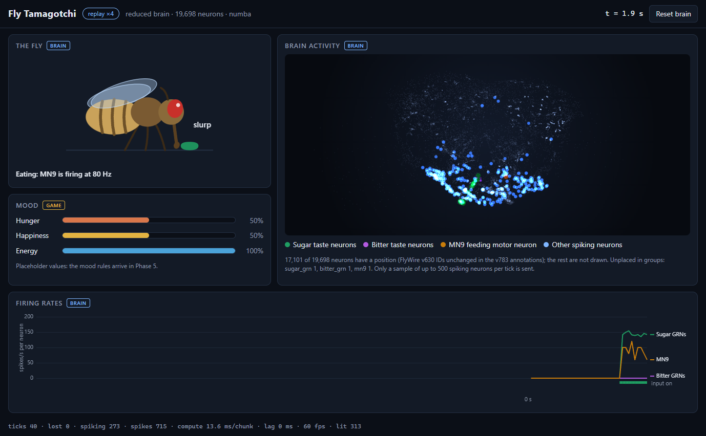

# Phase 4 Report: Laptop Dashboard

**Status: done.** The dashboard reads the server messages exactly as documented in
`reports/MESSAGE_FORMAT.md`. It renders a recorded session of real server output and the
live server in headless Chrome, and every validation check passes. `pytest -q`: 70 passed.

Open it at <http://localhost:8000/dashboard/>. To replay the recorded session instead of the
live brain, open `/dashboard/?replay=samples/session.jsonl`.



## What was built

| Part | Files | What it does |
|---|---|---|
| Neuron positions | `brain/positions.py`, `PositionsConfig` in `brain/config.py` | Reads `pos_x/y/z` for each neuron from the FlyWire annotation table and converts them to µm |
| HTTP routes | `server/dashboard.py`, 5 lines in `server/app.py` | Adds `GET /api/positions` and serves the page at `/dashboard/` (`/` redirects there). Also provides a replay-only app that does not load the brain |
| Page | `web/dashboard/index.html`, `style.css`, `main.js` | Layout and wiring. No build step |
| State reducer | `web/dashboard/state.js` | A pure function from messages to display state (fly state, chart buffers, spike queue, lost-tick count). Has no DOM, so Node can test it |
| Cartoon fly | `web/dashboard/fly.js` + CSS | A side-view SVG with four CSS states: idle, eating, disgusted, resting |
| Mood bars | `index.html` / `main.js` | Hunger, happiness and energy from `game.mood`. Labelled "placeholder" while `mood_rules_active` is false |
| 3D brain | `web/dashboard/brain3d.js` | three.js point cloud with 17,101 dots and a custom shader. Each `spiking_ids` entry flashes and fades with τ = 300 ms. Colours: sugar GRN green, bitter GRN purple, MN9 orange, other neurons blue. The view auto-rotates and can be dragged to orbit |
| Activity chart | `web/dashboard/chart.js` | Canvas chart of sugar GRN, bitter GRN and MN9 (`mn9_primary`) rates over the last 10 s of simulated time. Bands underneath show when each input was on, lines have labels at their ends, and hovering shows a crosshair and tooltip |
| Message sources | `web/dashboard/source.js` | Live WebSocket with auto-reconnect, or replay of a `.jsonl` recording at any speed. Replay can be paused and looped |
| Display config | `web/dashboard/config.js` | Every display threshold, colour and time constant |
| Recorder | `server/record_session.py`, `RECORD_SCRIPT` in `server/config.py` | Records a scripted session from a real server to `web/dashboard/samples/session.jsonl` |
| Validation | `server/validate_dashboard.py`, `DASHBOARD_CHECKS` in `server/config.py` | Drives headless Chrome over the DevTools protocol for the replay and live checks, and saves screenshots |
| Tests | `tests/test_dashboard.py`, `web/dashboard/tests/state.test.mjs` | 7 pytest tests (one of them runs the Node suite) and 10 Node tests |

The WebSocket message format did not change. The two new HTTP routes are added to
`MESSAGE_FORMAT.md`.

### How each fly state is chosen (display readout, no behavior)

The page picks the first state that holds, in this order: eating, disgusted, resting, idle.
A new state must hold for 150 ms before the fly changes (`stateHoldMs`).

| State | Shown when | Source |
|---|---|---|
| eating | `tick.game.eating` (the server's MN9 readout: `mn9_primary` ≥ 20 Hz over 500 ms) | **Brain** |
| disgusted | bitter GRN spike rate in the tick ≥ 20 Hz | **Brain** (sensory neuron spikes) |
| resting | `tick.game.light` ≤ 0.3 | Game input (light does not reach the brain) |
| idle | none of the above | — |

The dashboard never lowers eating because bitter is present. In the recording the fly looks
disgusted during sugar+bitter only because MN9 itself dropped below 20 Hz in the simulation
(table below). If the brain kept MN9 above threshold, the dashboard would show eating.

## The recorded sample

Recorded with `python -m server.record_session --spawn` on the reduced brain (19,698
neurons, numba backend). The recording runs baseline → sugar 3 s → pause → bitter 2.5 s →
pause → sugar+bitter 3 s → pause → dark (light 0.05) 3 s → light.

- 380 lines: 1 `hello`, 1 `ack` (reset_brain) and 372 `tick`s with seq 15–386 and no gaps,
  plus 6 phone-side context lines.
- 0.92 MB, committed as `web/dashboard/samples/session.jsonl`.

Per condition in the sample (the first 4 ticks after each onset are skipped for the MN9 mean):

| Inputs | Ticks | MN9 mean (Hz) | Ticks with `eating` | Max `n_spiking` |
|---|---|---|---|---|
| none | 201 | 0.2 | 8 (the 500 ms readout tail right after sugar ends) | 146 |
| sugar | 61 | 87.0 | 59 | 322 |
| bitter | 51 | 0.0 | 0 | 97 |
| sugar+bitter | 59 | 8.7 | 0 | 302 |

No tick had `spiking_ids_truncated: true`: the most neurons spiking in one tick was 322,
under the 500-ID cap. So in this sample the 3D view shows every spike.

## Test results

### `pytest -q` (full suite, all phases)

```
70 passed in 152.88s (0:02:32)
```

Seven of those tests are new in `tests/test_dashboard.py`:

- Positions are the annotation voxels × (0.004, 0.004, 0.040) µm, and only for IDs that
  exist in the table. Fake IDs get no position.
- The reduced-brain payload is consistent: `groups_unplaced` is exactly the group IDs
  without a position, and `mn9_primary` is placed.
- Page and route tests on the live app (toy brain) and on the replay app.
- Every sample tick has exactly the fields in MESSAGE_FORMAT.md. IDs are strings, there are
  at most 500 of them, and there are `min(n_spiking, 500)` of them. Each rate equals
  count / group size / window, and `eating` matches the 20 Hz threshold.
- The sample covers none, sugar, bitter, sugar+bitter, dark and eating.
- The Node suite runs and passes.

### Node (`node --test web/dashboard/tests/state.test.mjs`)

```
ℹ tests 10
ℹ pass 10
ℹ fail 0
```

These tests replay the recorded sample through `DashboardState`:

- All four fly states appear.
- Eating is never shown unless the server reported eating within the last 4 ticks.
- Steady sugar shows eating, bitter alone shows disgusted, and dark with no input shows resting.
- In the sample, MN9 during sugar+bitter is under half of MN9 during sugar.
- The chart window is trimmed correctly.
- Every spiking ID is delivered to the 3D view exactly once.
- Seq gaps count as lost ticks.
- Chart buffers clear on `reset_brain` and when `t_ms` jumps backwards.

### `python -m server.validate_dashboard` (headless Chrome 1400×950, SwiftShader WebGL)

The thresholds were fixed in `DASHBOARD_CHECKS` before the first run and were not changed.

```
== replay ==
  ticks applied 372/372, points 17101, max lit 397, flashes 29090, chart points 603
  fly states seen: idle, eating, disgusted, resting
  [PASS] every recorded tick applied
  [PASS] 3D view built
  [PASS] spiking neurons flashed
  [PASS] chart has data
  [PASS] all four fly states shown
  [PASS] fly SVG state matches state
  [PASS] mood bars filled
  [PASS] no JS errors

== live ==
  tick rate 20.00 Hz, lost 0.00%, median fps 59.9 (blank page 59.9), p95 tick age 28.7 ms
  JS work per frame: median 10.2 ms, p95 17.9 ms (GPU time not included)
  fly states seen: idle, eating, disgusted; reset: {'t_before_ms': 23350, 't_after_ms': 950, ...}
  [PASS] tick rate >= 0.9 x 20 Hz
  [PASS] lost ticks <= 2%
  [PASS] median fps >= 30
  [PASS] p95 tick age <= 150 ms
  [PASS] no JS errors
  [PASS] reset button restarts the brain
ALL CHECKS PASS
```

- **Screenshots:** `reports/phase4_screenshots/` has one per fly state from the replay
  (taken with playback paused) plus `live.png`.
- **Full results:** `data/phase4_validation.json` (gitignored).
- **Tick age** is `Date.now() − server_time_ms` when a tick is first drawn. Browser and
  server run on the same machine, so the clocks agree.

## Decisions

1. **Positions come only from unchanged root IDs, never interpolated.** This follows the
   rule already used for photoreceptors in `brain/neuron_groups.py`. Coverage:
   - Reduced brain: 17,101 of 19,698 neurons (86.8%).
   - Full brain: 106,214 of 127,400 (83.4%).
   - Unplaced group members: 1 of 21 sugar GRNs, 1 of 21 bitter GRNs and the non-primary
     MN9 (1 of 2).
   - `mn9_primary` is placed.

   The page prints these counts under the 3D view.
2. **Coordinates:** I used `pos_*` (the backbone anchor, present for every row) rather than
   `soma_*` (missing for some rows). Units: the annotation README says "4x4x40nm voxel
   space", which I checked against the pinned commit's `supplemental_files/README.md`. The
   y axis is flipped so dorsal is up. The camera starts on a front view along the section
   axis. In the screenshots the active taste and MN9 neurons sit at the bottom of the brain,
   where the subesophageal zone is, which is the expected place.
3. **three.js 0.170.0 from jsDelivr** instead of vendoring about 1 MB into git. If it fails
   to load, the 3D panel shows a message and the rest of the page keeps working.
4. **The recorded sample is committed.** It is our own server output, not connectome data,
   so the Node tests need neither the brain nor `data/`. Positions are not committed: they
   are always computed from `data/`.
5. **Replay without the brain:** `create_replay_app()` serves the page and the positions for
   the brain mode named in the sample's `hello`. It reads the ID list from
   `data/reduced_circuit.json`, so validation does not load the connectome for the replay part.
6. **Palette:** checked with the dataviz skill's `validate_palette.js` on the dark surface
   `#131a26`. All checks pass (worst deutan ΔE 19.1). My first palette failed the
   lightness band and I darkened it until it passed. The dashboard is dark-only.
7. **Frame budget fix:** the first validation run measured a median of **30.0 fps**, exactly
   on the threshold, while a blank page ran at 60. I made two changes:
   - The chart redraws only when a new tick arrives or the pointer moves (20 Hz instead of 60).
   - CSS colours are read once instead of on every frame.

   The next run measured 59.9 fps, the same as the blank page. The threshold was not changed.

## Open problems / limitations

- **No real GPU or real browser window measured.** All numbers come from headless Chrome
  with SwiftShader (CPU WebGL). A GPU should be faster, but I did not measure one. I have
  not looked at the page on a physical laptop display. The replay run itself reports a
  30 fps median, because 4× playback delivers 80 ticks/s and the screenshot pauses fall
  inside the measurement. That number is not checked.
- **The live check did not reach the dark phase.** The 12 s live window ends before the
  script's dark phase starts at about 14.5 s, so resting was seen only in the replay (live
  showed idle, eating and disgusted). The resting logic is the same code in both modes.
- **"Disgusted" reads the bitter GRNs themselves.** Those neurons are the ones driven by
  the input, so the face mostly says "bitter input is on, as seen in spikes". It does not
  read a downstream aversion circuit. The effect on eating comes from MN9 and is real
  brain output.
- **The 3D view shows a sample of spikes.** At most 500 spiking IDs per tick are sent. The
  reduced brain never exceeded 322 in the recording, but the full brain would, and there
  the flashes would be a random sample.
- **About 13% of reduced-brain neurons are never drawn** (no v783 match). Getting their
  positions would need FlyWire's v630 coordinate table from Codex (login required), which
  I have not tried.
- **Offline use:** three.js comes from the CDN. A classroom without internet needs a
  vendored copy.
- **Mood bars are placeholders** (hunger 0.5, happiness 0.5, energy 1.0) until Phase 5.
  The dashboard has no mood logic.
- **The Phase 3 QR code is not here.** It belongs to the Phase 3 branch, which is being
  built in parallel. Both branches edit `server/app.py`: this branch adds one import and
  one `add_dashboard_routes(...)` call, so a merge conflict is likely small.
- **The pytest wrapper needs Node.js.** It fails with a clear message instead of skipping.
